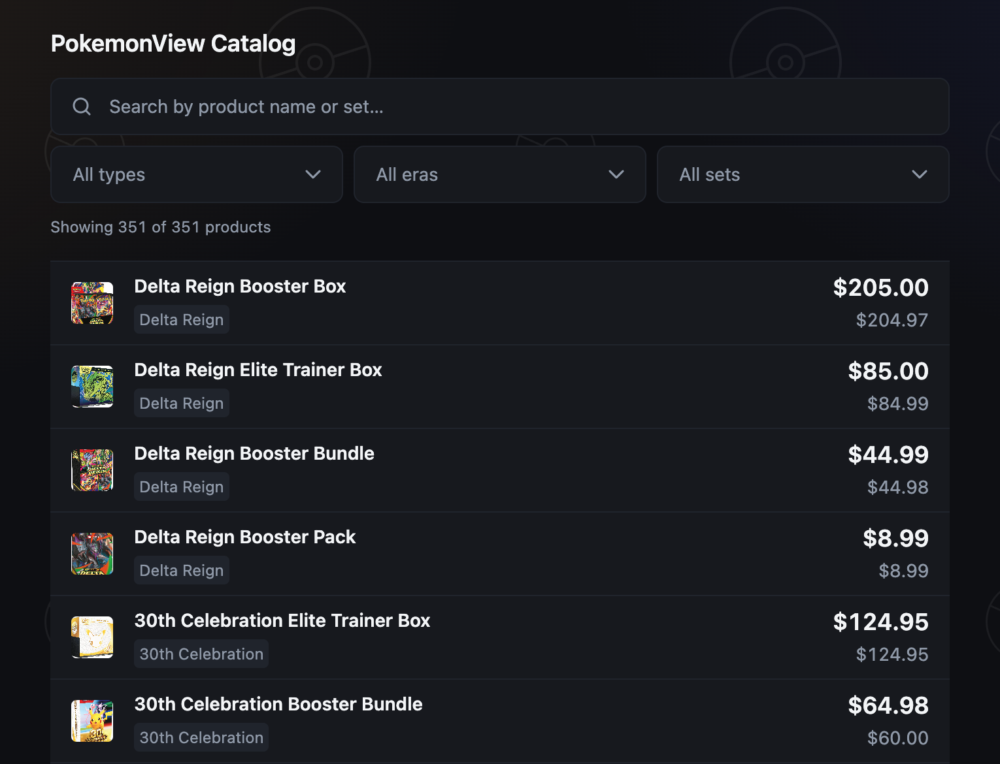
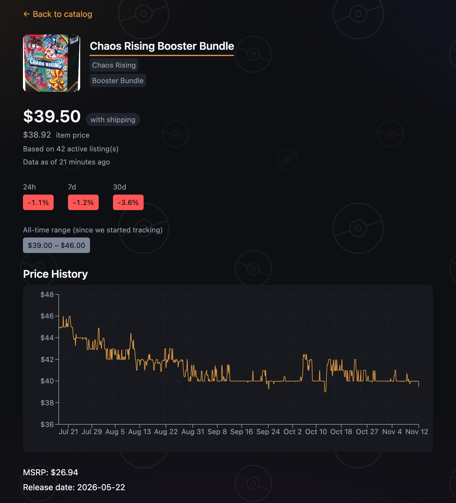

# PokemonView

Price tracking for sealed Pokémon TCG products, powered by live eBay listings.

**[pokemonview.xyz](https://pokemonview.xyz)** · **[Live API](https://pokemonview.fly.dev/products)**

[](https://github.com/nkhmaladze/PokemonView/actions/workflows/ci.yml)

<p align="center">
  
</p>

## Features

- **350+ products across 130 sets.** Booster packs, booster boxes, bundles and Elite Trainer Boxes.
- **Fresh prices.** Listings are pulled from eBay every 4 hours.
- **Trends at a glance.** Each product shows 24-hour, 7-day and 30-day trend badges and its all-time price range.
- **Price history.** Every product page charts how its price has moved over time.
- **Fast browsing.** Search by name and filter by product type, era and set.

<p align="center">
  
</p>

## How it works

```
eBay listings
     │   every 4 hours
     ▼
Ingestion worker ──► raw listings
     │
     ▼
Matching ─────────► one price point per product
     │
     ▼
Flask REST API ───► React app
```

**Ingestion.** A scheduled worker pulls active listings for every product in the catalog. Runs are idempotent and guarded by a database lock, so they never overlap, and an alert fires if the data goes stale.

**Matching.** eBay titles are messy, so each listing goes through a two-tier matcher. Exact keyword rules run first, with a bounded fuzzy match as a fallback. Lots, damaged items, counterfeits and accessories are excluded, and statistical outliers are filtered out before prices are aggregated.

**Serving.** A Flask API serves current prices and price history to a React single-page app.

## Tech stack

| Layer | Tools |
|---|---|
| Backend | Python, Flask, gunicorn, APScheduler, RapidFuzz |
| Frontend | React, React Router, Recharts, Vite |
| Database | MongoDB Atlas |
| Hosting | Fly.io (API and worker), Vercel (frontend) |
| CI/CD | GitHub Actions: tests, lint and build on every push, automatic deploy from `main` |
| Testing | pytest (200+ backend tests), Vitest and Testing Library |

## API

| Endpoint | Returns |
|---|---|
| `GET /products` | Every product with its current price, listing count and trend |
| `GET /products/<id>` | A single product |
| `GET /products/<id>/history` | The price history for one product |

## Getting started

You need Python 3.12, Node 22, a MongoDB instance and eBay Developer Program credentials.

```bash
# Backend
cp .env.example .env            # add your eBay credentials and MONGODB_URI
pip install -r requirements.txt
python -m scripts.seed_catalog  # load the product catalog
python -m scripts.ingest_worker # start scheduled ingestion
gunicorn --bind 0.0.0.0:8080 wsgi:app

# Frontend
cd frontend
npm ci
VITE_API_BASE_URL=http://localhost:8080 npm run dev
```

## Tests

```bash
pytest -q                 # backend
cd frontend && npm test   # frontend
```
